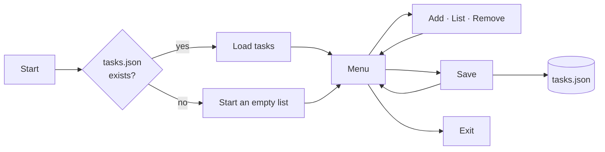

<div align="center">

# 📋 Priority Task Manager

**An interactive command-line to-do list in Python, with color-coded priorities and JSON persistence**


[](https://colab.research.google.com/github/Laurentius96/Priority_Task_Manager/blob/main/main.ipynb)

<p>
  <a href="#-overview">Overview</a> •
  <a href="#-features">Features</a> •
  <a href="#-how-it-works">How It Works</a> •
  <a href="#-sample-session">Sample Session</a> •
  <a href="#-how-to-run">How to Run</a> •
  <a href="#-license">License</a>
</p>

</div>

---

## 🔍 Overview

**Priority Task Manager** is a menu-driven terminal app to add, list, remove and save tasks, each with a priority level shown as a colored marker. It was built as a Python case in the **DNC School Data Scientist program**, following the course's step-by-step task-list case (data types, control flow, data structures, functions and files) and extending the final version with a formatted interface and input checks.

| Concept | Where it shows up |
|---|---|
| 🧱 Data structures | Each task is a dictionary (`name`, `priority`) stored in a list |
| 🧩 Functions | One function per operation, plus layout helpers |
| 🔁 Control flow | Main menu loop and conditional priority markers |
| 🛡️ Input handling | Numeric menu check (`ValueError`), empty-name check, default priority |
| 💾 File I/O | Load and save with the `json` module |

## ✨ Features

| Option | Action | Details |
|:---:|---|---|
| 1 | ➕ Add task | Name (required) and priority; an empty priority becomes **Medium** |
| 2 | 📋 List tasks | Numbered list with a colored priority marker |
| 3 | 🗑️ Remove task | Shows the tasks, then removes one by name (case-insensitive) |
| 4 | 💾 Save | Writes the list to `tasks.json` |
| 5 | 🚪 Exit | Closes the program (unsaved changes are discarded) |

**Priority markers:**

| Marker | Priority typed |
|:---:|---|
| 🔴 | `High` or `Urgent` |
| 🟡 | `Medium` |
| 🟢 | Anything else, such as `Low` |

Priorities are matched case-insensitively.

## 🧭 How It Works



Tasks are saved as a JSON list ([`tasks.json`](tasks.json) holds one sample task):

```json
[{"name": "T1", "priority": "Low"}]
```

## 🎬 Sample Session

<details open>
<summary><b>Adding tasks and listing them</b> (real output, trimmed; typed values shown after each prompt)</summary>
<br>

```text
============================================================
                       📋 TASK MANAGER                       
============================================================
➕ ADD NEW TASK
============================================================
📝 Task name: Study pandas

🔥 Priority options:
   • High/Urgent
   • Medium
   • Low

🎯 Task priority: High

✅ Task added successfully!
📝 Study pandas | 🔥 Priority: High

...

============================================================
📋 TASK LIST
============================================================
 1. 🟢 T1
     └─ Priority: Low

 2. 🔴 Study pandas
     └─ Priority: High

 3. 🟡 Review pull request
     └─ Priority: Medium
```

The third task was added with an empty priority, so it defaulted to **Medium**.

</details>

## 🚀 How to Run

**Option 1: Google Colab (no installation).** Click the **Open in Colab** badge above and run the code cell.

**Option 2: Jupyter.**

```bash
git clone https://github.com/Laurentius96/Priority_Task_Manager.git
cd Priority_Task_Manager
pip install notebook
jupyter notebook main.ipynb
```

**Option 3: terminal (best experience, since screen clearing only works in a terminal).**

```bash
jupyter nbconvert --to script main.ipynb
python main.py
```

Only the Python standard library is used (`json`, `os`); Python 3.8 or newer is recommended.

## 🚧 Limitations

- **Saving is manual:** use option 4 before exiting; the program does not save on exit.
- Priorities are free text: only `High`, `Urgent` and `Medium` get their own markers, and the list is shown in insertion order, not sorted by priority.
- Removing a task requires typing its name; the numbers in the list are for display only.
- In Jupyter and Colab, the screen-clearing calls have no effect, so the output keeps growing.

## 📁 Project Structure

```
📁 Priority_Task_Manager/
├── 📓 main.ipynb     # The whole application in one code cell
├── 📄 tasks.json     # Saved tasks (one sample entry)
├── 📄 LICENSE.md     # CC BY-NC-ND 4.0
└── 📄 README.md
```

## 🤝 Contributing

Contributions, ideas and feedback are welcome!

- 🐛 **Found a bug or something unclear?** [Open an issue](https://github.com/Laurentius96/Priority_Task_Manager/issues/new) describing what happened and how to reproduce it.
- 💡 **Have an idea or a question?** [Open an issue](https://github.com/Laurentius96/Priority_Task_Manager/issues/new) and tell me about it.
- 🔧 **Want to propose a fix?** Fork the repository, create a branch (`git checkout -b fix/short-description`), commit your changes and open a pull request explaining what changed and why.

By contributing, you agree that your contribution is shared under the same license as this project.

## 📜 License

This project is licensed under the [Creative Commons Attribution-NonCommercial-NoDerivatives 4.0 International License (CC BY-NC-ND 4.0)](LICENSE.md). The case statement belongs to DNC School.

**What this means:**
- ✅ You may **share** this work with **attribution**
- ❌ You may **not** use it for **commercial purposes**
- ❌ You may **not** distribute **modified versions**

---

<div align="center">

**Lorenzo C. Bianchi** · [GitHub](https://github.com/Laurentius96) · [LinkedIn](https://www.linkedin.com/in/cb-lorenzo/)

</div>
